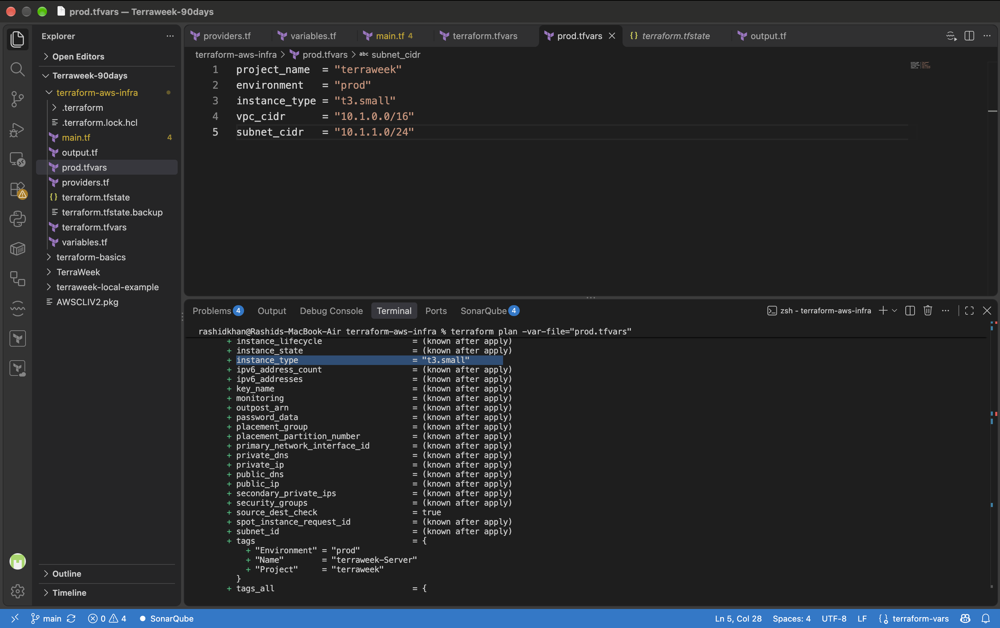
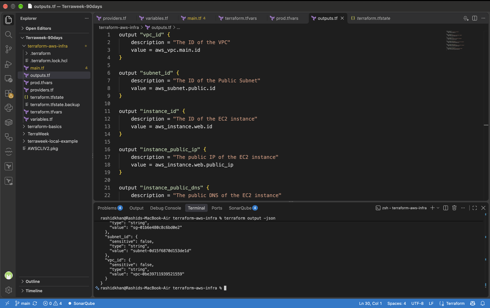
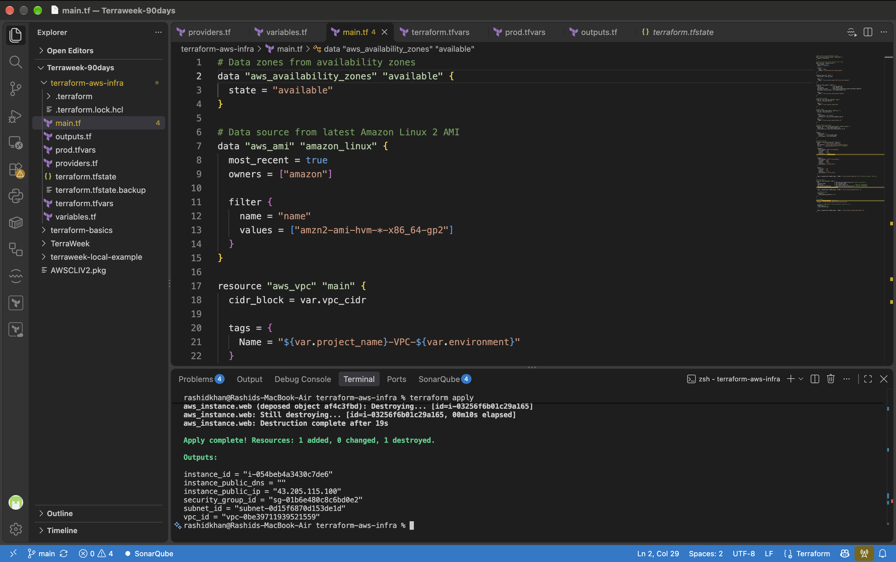
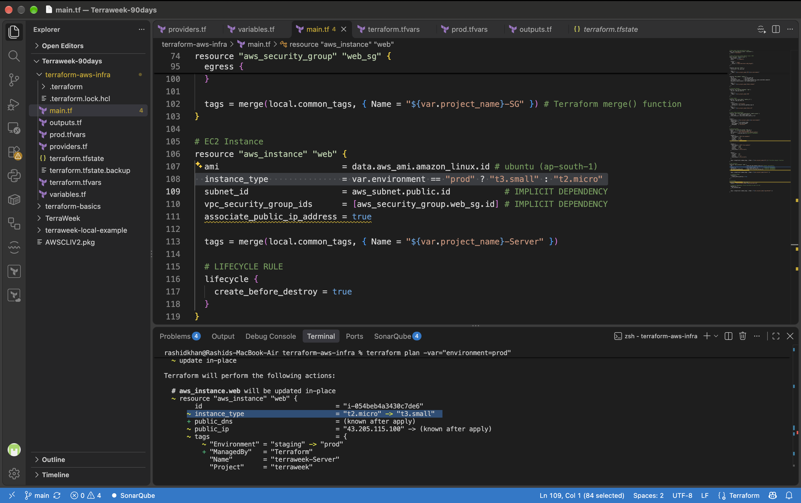
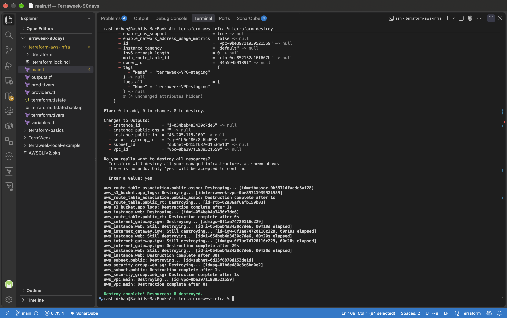

# Day 63: Variables, Outputs, Data Sources and Expressions

## Task 1: Extract Variables

Refactored the static infrastructure configuration into a dynamic, parameterized model by extracting all hardcoded values into a `variables.tf` file.

**Q: What are the five variable types in Terraform?**
According to the official HashiCorp documentation, the primary variable types are:
1.  **string**: A sequence of Unicode characters representing text (e.g., "ap-south-1").
2.  **number**: A numeric value, which can be an integer or fractional value.
3.  **bool**: A boolean value, either `true` or `false`.
4.  **list**: A sequence of values of the same type, identified by consecutive whole numbers starting with zero.
5.  **map**: A collection of values where each is identified by a string label (key).

## Task 2: Variable Files and Precedence

Created explicit environment variable files to separate development logic from production logic.

**`terraform.tfvars` (Default)**
```hcl
project_name  = "terraweek"
environment   = "dev"
instance_type = "t2.micro"
```

**`prod.tfvars`**
```hcl
project_name  = "terraweek"
environment   = "prod"
instance_type = "t3.small"
vpc_cidr      = "10.1.0.0/16"
subnet_cidr   = "10.1.1.0/24"
```

**Q: Write the variable precedence order from lowest to highest priority.**
According to official Terraform documentation, Terraform loads variables in the following order, with later sources taking precedence over earlier ones:
1.  Environment variables (e.g., `TF_VAR_environment`)
2.  The `terraform.tfvars` file, if present.
3.  The `terraform.tfvars.json` file, if present.
4.  Any `*.auto.tfvars` or `*.auto.tfvars.json` files, processed in lexical order of their filenames.
5.  Any `-var` and `-var-file` options on the command line, in the order they are provided.

**Screenshot:**
- `task-02-prod-plan.png` (Verification of prod.tfvars taking precedence).


## Task 3: Add Outputs

Created an `outputs.tf` file to extract operational data after deployment.

```hcl
output "instance_public_ip" {
  description = "The public IP of the EC2 instance"
  value       = aws_instance.web.public_ip
}
# Additional outputs truncated for brevity
```

**Verify: Does `terraform output instance_public_ip` return the correct IP?**
Yes. Running `terraform output instance_public_ip` returned `"43.205.115.100"`, which exactly matched the public IP assigned to the EC2 instance upon successful provisioning.

**Screenshots:**
- `task-03-apply-outputs.png` (Terminal output showing all 6 outputs post-apply).
- `task-03-state-list.png` (Verification of state and JSON outputs).


## Task 4: Use Data Sources

Replaced hardcoded AMI IDs and Availability Zones with dynamic data blocks.

**Q: What is the difference between a resource and a data source?**
According to HashiCorp documentation:
-   **Resource**: Describes one or more infrastructure objects. Resources are the primary constructs in Terraform, used to create, update, and delete infrastructure. Terraform manages their complete lifecycle.
-   **Data Source**: Allows data to be fetched or computed for use elsewhere in Terraform configuration. Data sources are read-only; they do not create or manage infrastructure, but rather query existing infrastructure or APIs to retrieve information (e.g., fetching the latest AMI ID dynamically).

**Screenshot:**
- `task-04-data-sources.png` (Verification of EC2 replacement with dynamic AMI).


## Task 5: Use Locals for Dynamic Values

Implemented a `locals` block to enforce consistent tagging and naming conventions across all resources.

```hcl
locals {
  name_prefix = "${var.project_name}-${var.environment}"
  common_tags = {
    Project     = var.project_name
    Environment = var.environment
    ManagedBy   = "Terraform"
  }
}
```
All resource tags were updated using the `merge()` function to combine `local.common_tags` with resource-specific attributes.

## Task 6: Built-in Functions and Conditional Expressions

Implemented a conditional expression to dynamically select the EC2 instance type based on the active environment:
```hcl
instance_type = var.environment == "prod" ? "t3.small" : "t2.micro"
```

**Q: Pick five functions you find most useful and explain what each does.**
1.  **`merge()`**: Takes one or more maps and returns a single map containing a merged set of elements. Highly useful for standardizing resource tags.
2.  **`upper()`**: Converts all lowercase letters in a given string to uppercase. Useful for standardizing naming conventions.
3.  **`join()`**: Produces a string by concatenating together all elements of a given list of strings with a specified delimiter.
4.  **`cidrsubnet()`**: Calculates a subnet address within a given IP network address prefix. Crucial for automated VPC network segmentation without manual IP math.
5.  **`lookup()`**: Retrieves the value of a single element from a map, given its key. If the key does not exist, it returns the provided default value.

**Screenshots:**
- `task-05-conditional.png` (Plan output showing dynamic instance type change).
- `task-05-destroy.png` (Successful reverse-order teardown of the infrastructure).


---

## Final Documentation Requirements

**Difference between Variable, Local, Output, and Data:**
-   **Input Variables (`variable`)**: Serve as parameters for a Terraform module, allowing users to customize behavior without editing the source code.
-   **Local Values (`locals`)**: Assign a name to an expression or value, allowing it to be used multiple times within a module without repeating the calculation.
-   **Output Values (`output`)**: Return values from a Terraform module to the CLI or to other modules, exposing data about the provisioned infrastructure.
-   **Data Sources (`data`)**: Query external APIs or existing infrastructure to fetch read-only data that Terraform does not manage, returning values for use in the configuration.
