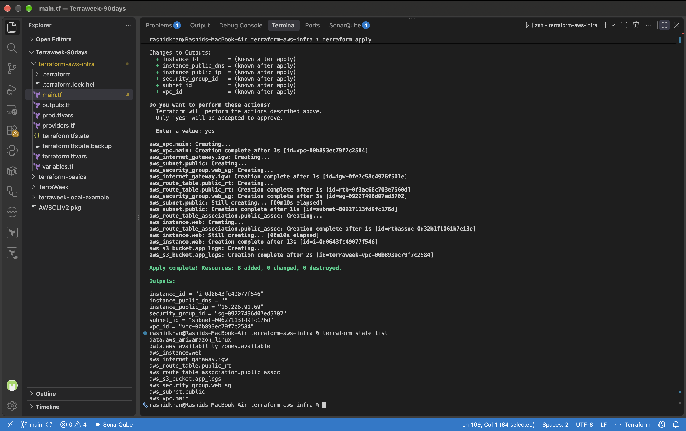
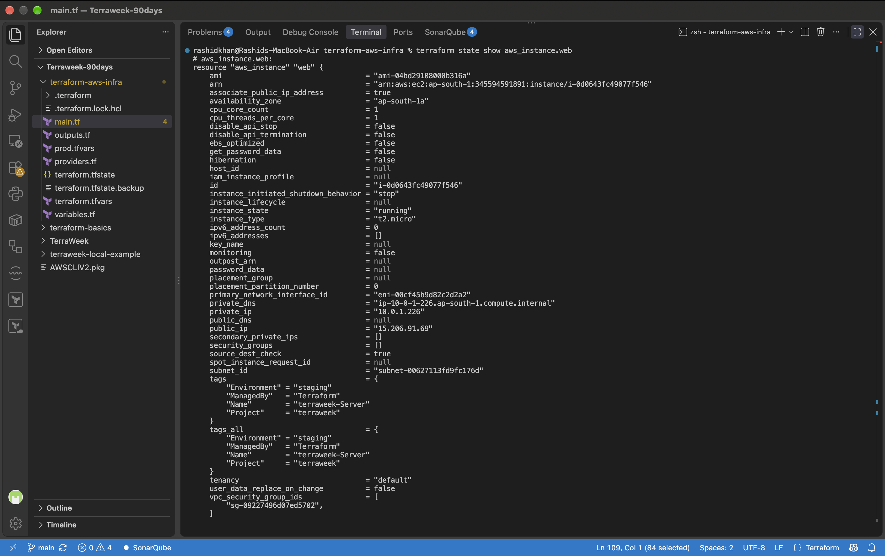
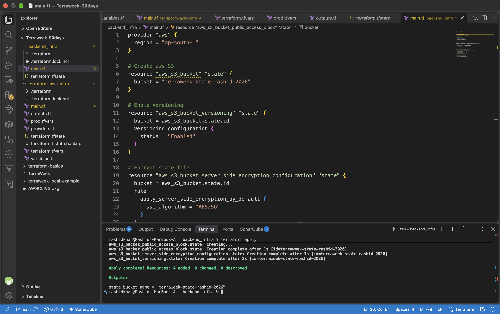
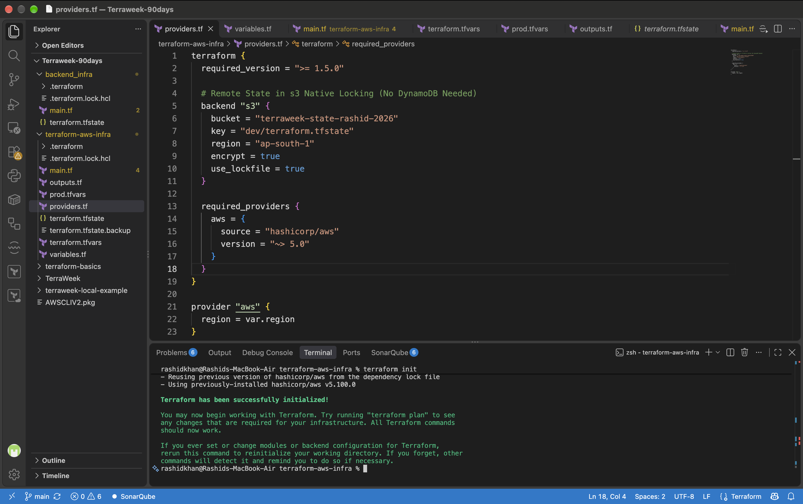
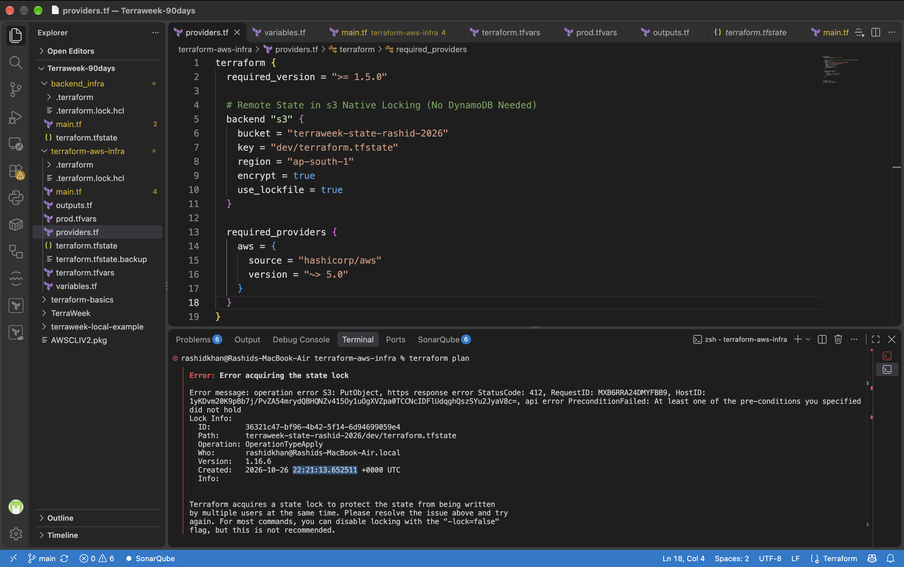
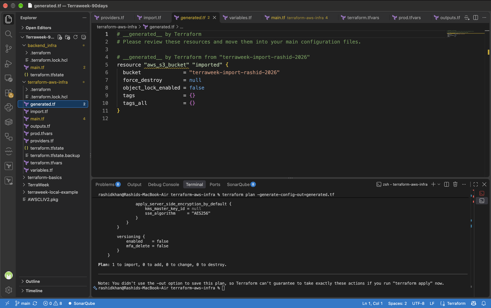
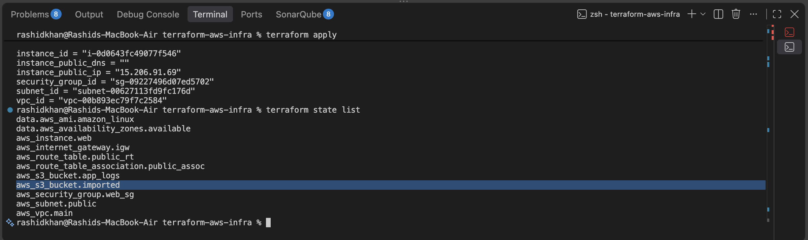
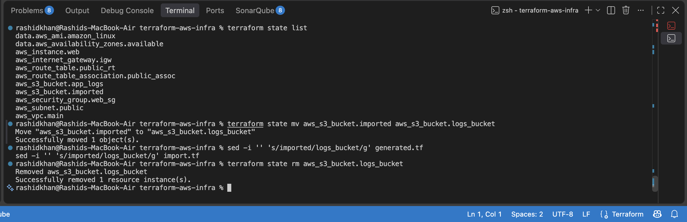
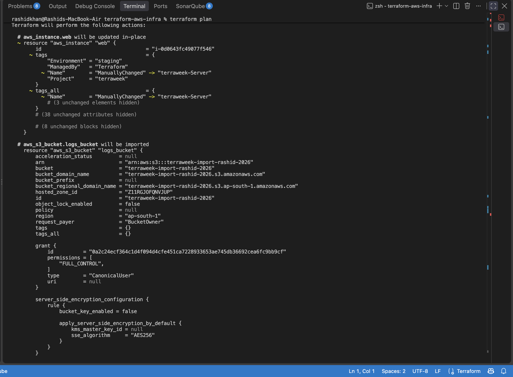

# Day 64: Terraform State Management and Remote Backends

## Task 1: Inspect Your Current State

Applied the existing AWS networking and compute configuration and inspected the state file.

**Answers to Task 1 Questions:**
1.  **How many resources does Terraform track?**
    Based on the execution of `terraform state list`, Terraform is actively tracking 11 resources (including data sources, VPC components, EC2, and S3).
2.  **What attributes does the state store for an EC2 instance?**
    According to the execution of `terraform state show aws_instance.web`, the state stores every computed and defined attribute of the instance. This includes attributes not explicitly written in the configuration, such as `arn`, `primary_network_interface_id`, `private_dns`, `cpu_options`, `root_block_device` configurations, and AWS-assigned IDs.
3.  **What does the serial number represent?**
    According to official HashiCorp documentation, the `serial` attribute is a version number for the state file. It increments on every state modification. Terraform uses this integer to ensure it does not accidentally overwrite a newer state file with an older one.

**Screenshots:**
-  (List of 11 tracked resources)
-  (Deep dive into the EC2 instance attributes)

## Task 2: Set Up S3 Remote Backend

Migrated the local `terraform.tfstate` to a remote AWS S3 backend. Utilizing Terraform 1.11+ best practices, native S3 state locking (`use_lockfile = true`) was implemented, bypassing the legacy DynamoDB requirement.

**Screenshots:**
-  (Creation of the secure S3 state bucket)
-  (Successful migration confirmation in terminal)

## Task 3: Test State Locking

Simulated a concurrent execution environment by running `terraform apply` in Terminal 1 (paused) and executing `terraform plan` in Terminal 2.

**Documentation:**
-   **What is the error message?**
    The terminal threw the following error:
    `Error acquiring the state lock`
    `api error PreconditionFailed: At least one of the pre-conditions you specified did not hold`
    `Operation: OperationTypeApply`
-   **Why is locking critical for team environments?**
    According to Terraform documentation, state locking prevents others from acquiring the lock and potentially corrupting the state. In team environments or CI/CD pipelines, if multiple processes attempt to write to the state file concurrently, it can lead to state corruption, resource conflicts, and catastrophic infrastructure data loss.

**Screenshot:**
-  (Terminal output showing the lock acquisition failure)

## Task 4: Import an Existing Resource

Manually provisioned an S3 bucket via AWS CLI (`terraweek-import-rashid-2026`) and adopted it into Terraform management using the modern `import {}` block and the `-generate-config-out` parameter.

**Documentation:**
-   **What is the difference between terraform import and creating a resource from scratch?**
    According to HashiCorp documentation, standard resource creation involves Terraform calling cloud provider APIs to provision net-new infrastructure. The `import` function, conversely, maps an existing, already-provisioned cloud resource to a Terraform configuration block, bringing it under Terraform's management without recreating it.

**Screenshots:**
-  (Execution of generate-config-out)
-  (Verification of imported bucket in state list)

## Task 5: State Surgery -- mv and rm

Executed non-destructive state surgery commands.
1.  Renamed the imported bucket within the state using `terraform state mv aws_s3_bucket.imported aws_s3_bucket.logs_bucket` and aligned the `.tf` files.
2.  Removed the bucket from state tracking using `terraform state rm aws_s3_bucket.logs_bucket`.

**Documentation:**
-   **When would you use state mv in a real project?**
    According to official documentation, `state mv` is used when renaming a resource or moving it into a child module. It updates the resource's logical address in the state file without triggering a destructive recreation of the actual cloud infrastructure.
-   **When would you use state rm?**
    `state rm` is used to remove a resource binding from the Terraform state. The underlying physical cloud resource is not destroyed. This is critical when transitioning the management of a resource to another tool, another Terraform workspace, or manual management.

**Screenshot:**
-  (Execution of mv, sed, and rm commands)

## Task 6: Simulate and Fix State Drift

Induced state drift by utilizing the AWS CLI to manually modify the `Name` tag of the EC2 instance to `ManuallyChanged`. Executing `terraform plan` successfully detected the configuration divergence. Executing `terraform apply` forced the cloud environment to reconcile back to the defined Infrastructure as Code state.

**Documentation:**
-   **How do teams prevent state drift in production?**
    State drift is prevented by strictly enforcing the Principle of Least Privilege. Direct "write" access to production environments via the AWS Management Console or AWS CLI is revoked for human users. All infrastructure modifications are mandated to pass through version control (Git) and are exclusively deployed via automated CI/CD pipelines (e.g., GitHub Actions, Jenkins).

**Screenshot:**
-  (Plan output detecting the tag divergence)

---

## Documentation Section

### Local State vs Remote State Setup

```text
[ LOCAL STATE ARCHITECTURE ]
Developer Workstation
+-------------------+       +-------------------+
|   main.tf         |       |   AWS Cloud       |
|   terraform.tfstate|<----->|   (Resources)     |
+-------------------+       +-------------------+
* High risk of data loss. No team collaboration.

[ REMOTE STATE ARCHITECTURE (2026 Standard) ]
Developer 1            Developer 2            CI/CD Pipeline
+---------+            +---------+            +---------+
| main.tf |            | main.tf |            | main.tf |
+----+----+            +----+----+            +----+----+
     |                      |                      |
     +----------------------+----------------------+
                            v
+-----------------------------------------------------------+
|                   AWS S3 Backend Bucket                   |
|  - dev/terraform.tfstate (Encrypted & Versioned)          |
|  - dev/.tflock (Native State Locking)                     |
+-----------------------------------------------------------+
                            |
                            v
                    +---------------+
                    |   AWS Cloud   |
                    +---------------+
```

### Official Command Definitions
- **state mv**: Moves a resource to a different address in the state file.
- **state rm**: Removes an item from the Terraform state, completely decoupling it from Terraform management without destroying the real infrastructure.
- **import**: Maps an existing cloud infrastructure resource to a Terraform configuration block.
- **force-unlock**: Manually removes a lock on the state for the current configuration. This must only be used if a lock has become orphaned (stale) and you are absolutely certain no other applies are running.
- **refresh**: Reads the current settings from all managed remote objects and updates the Terraform state to match. (Note: Primarily achieved now via `terraform apply -refresh-only`).
